# Restyling — proposta per Luca

Tutto è sul branch `proposta-miglioramenti`. Su `main` non è cambiato nulla, e nemmeno il foglio Google: dati, link e indirizzi restano gli stessi.

## Prima e dopo

| | Prima | Dopo |
|---|---|---|
| Archivio (telefono) | 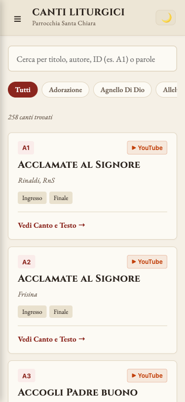 | 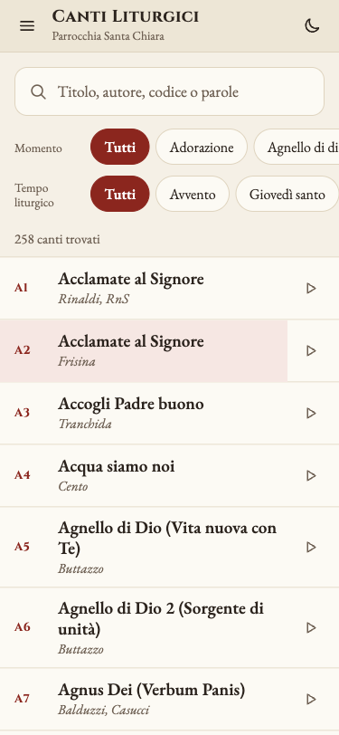 |
| Pagina canto (telefono) | 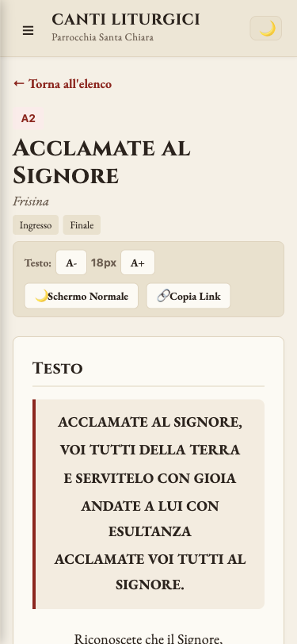 | 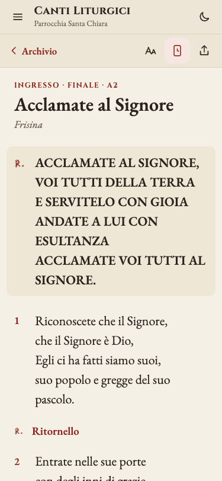 |
| Celebrazione (telefono) | 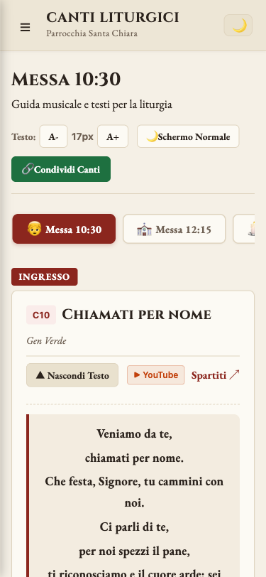 | 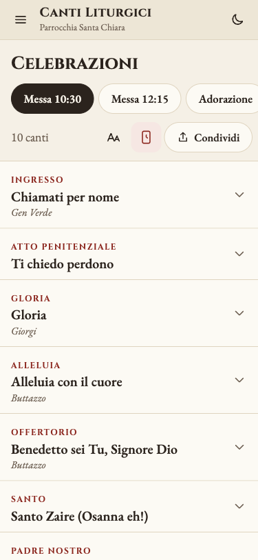 |
| Tema scuro, canto |  | 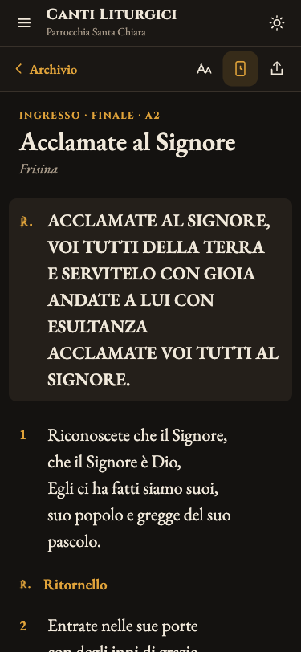 |
| Archivio su iPad | 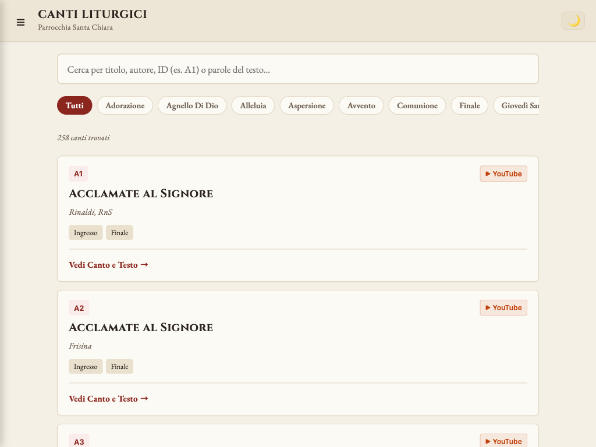 | 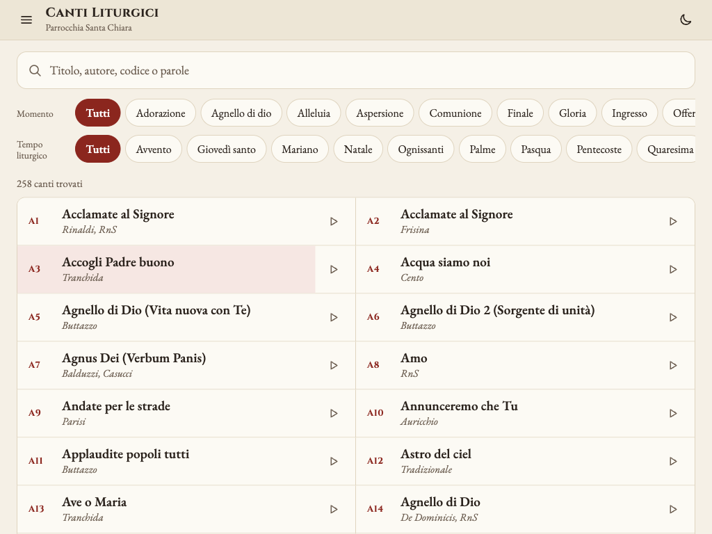 |

Novità che "prima" non aveva:

| Canto aperto da una celebrazione | Canto su iPad orizzontale |
|---|---|
| 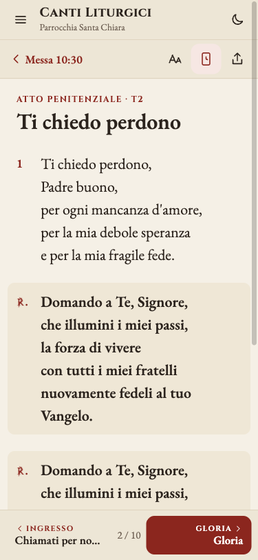 | 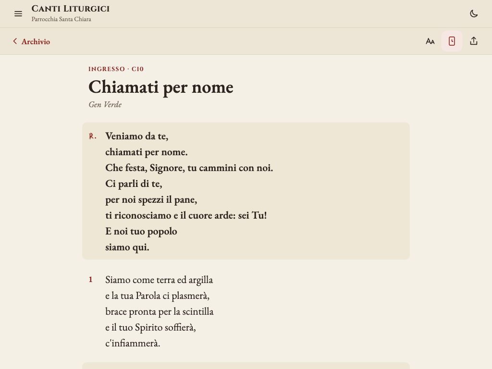 |

La tavola con la direzione grafica è in [direzione.html](direzione.html).

## Cosa cambia

**Grafica** (stessi colori, stessi font, stesso tema scuro)
- Le indicazioni sono in rosso, come le rubriche nei libri liturgici: il momento della messa, il numero della strofa, il segno ℟ del ritornello. Il testo da cantare resta nero.
- Il testo parte più grande (22 px, si può portare fino a 36 px) ed è allineato a sinistra. Il ritornello è in grassetto su un fondo leggero.
- I titoli dei canti non sono più tutti in maiuscolo: si leggono più in fretta.
- Le emoji nei pulsanti sono state sostituite da icone disegnate, tutte uguali.
- L'archivio è a righe invece che a schede: in uno schermo si vedono 6–7 canti invece di 2. Su iPad le righe sono su due colonne.

**Comodità durante la messa e le prove**
- Lo schermo resta acceso da solo sulle pagine dei canti e delle celebrazioni, e si riaccende da solo quando si torna sull'app. Si può comunque spegnere con l'icona in alto.
- Dalla celebrazione si apre un canto e si passa al successivo (o al precedente) con la barra in basso, senza tornare alla lista.
- Nella celebrazione i testi sono chiusi: la lista è compatta e si apre solo il canto che serve.
- Due filtri separati nell'archivio: **Momento** (ingresso, comunione…) e **Tempo liturgico** (quaresima, pasqua…). Si possono combinare, per esempio "comunione + quaresima".
- Gli spartiti non si caricano più all'apertura della pagina: ci sono i pulsanti Apri, Scarica e Anteprima. La pagina si apre più veloce, soprattutto con poco segnale.

**Correzioni**
- Cambiare scheda tra le celebrazioni (10:30 → 12:15 → Adorazione) faceva riscaricare ogni volta i dati da Google. Ora non succede più.
- Un codice sbagliato nel foglio delle celebrazioni (per esempio "ALDO") ora compare come "Canto ALDO non in archivio" e viene saltato dalle frecce.
- Il codice duplicato per schermo acceso, cache e dimensione del testo è stato riunito in un solo punto.

**Raccoglitore**
- Ogni canto mostra se è nel raccoglitore cartaceo ("Nel raccoglitore: A12" oppure "Non nel raccoglitore"). Nell'archivio c'è il filtro "Solo nel raccoglitore".
- Regola: un canto è nel raccoglitore se ha un riferimento. Si legge da una colonna **Raccoglitore** nel foglio Canti.
- Finché la colonna non c'è, l'app considera tutti i canti già nel raccoglitore, con riferimento uguale all'ID: oggi non cambia nulla.
- Per attivarla: aggiungere la colonna "Raccoglitore" in fondo al foglio Canti, scrivere `=A2` nella prima riga e trascinare fino in fondo, poi svuotare la cella dei canti che non sono nel raccoglitore. Se un giorno il riferimento è diverso dall'ID, basta scriverlo nella cella.

**Cosa non è cambiato**
- Il foglio Google e le sue colonne.
- I link già condivisi su WhatsApp, anche quelli vecchi con `?messa=`.
- L'accesso admin nascosto (5 tocchi su "Parrocchia Santa Chiara").
- Il funzionamento offline.

## Provarla dal vivo

Sul PC di Andrea, dalla cartella del progetto:

```bash
npm install
npm run dev -- --host
```

Poi, da un telefono collegato **allo stesso Wi-Fi**, si apre `http://<IP del PC>:5173/canti-liturgici-santa-chiara/`. L'IP del PC si trova su Mac in Impostazioni di Sistema → Wi-Fi → Dettagli.

## Se piace, se non piace

- **Piace tutto**: si unisce il branch a `main` e GitHub Pages pubblica da solo.
- **Piace una parte**: ogni passaggio è un commit separato (correzioni, filtri, grafica, celebrazioni…) e si può tenere solo quello che serve.
- **Non piace**: basta non unire il branch. Su `main` non è cambiato niente.

L'analisi completa, con le idee per i passi successivi (velocità, pulizia dati, versione aperta ad altre parrocchie), è in [`docs/superpowers/specs/2026-11-06-analisi-miglioramenti-design.md`](../superpowers/specs/2026-11-06-analisi-miglioramenti-design.md).
